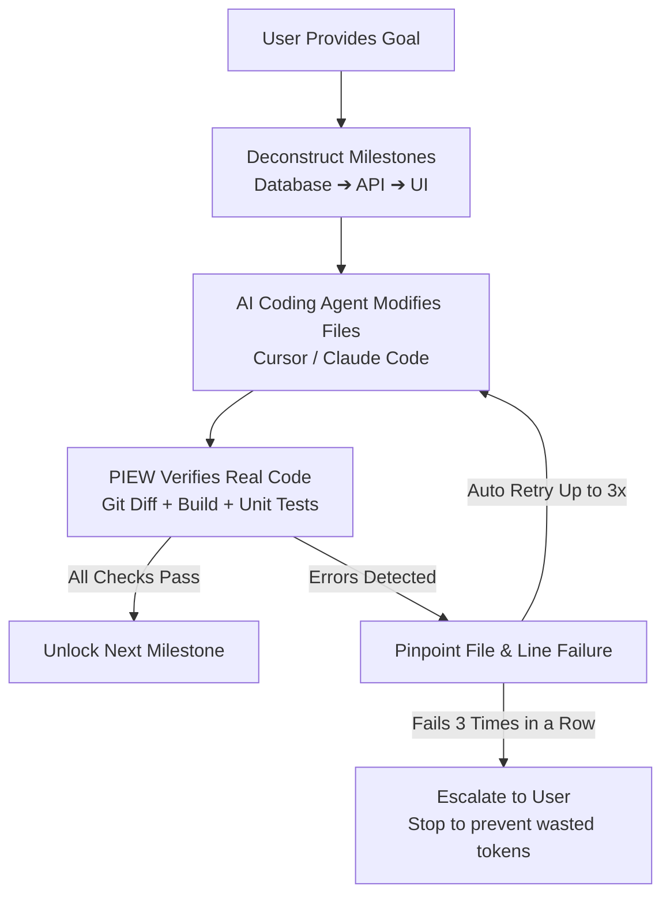
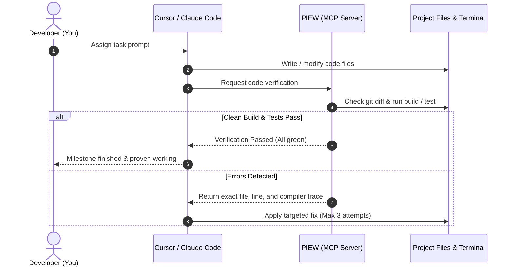

**English** · [Bahasa Indonesia](docs/readme/README_id.md)

# PIEW: Prompt Intelligence & Engineering Workspace

### Quality Supervisor and Steering Tool for AI Coding Agents

**Check AI-generated code (Cursor, Claude Code, Windsurf) using git diffs, build checks, and test suites so tasks finish accurately without infinite loops or broken code.**

[](https://www.typescriptlang.org/)
[](https://nodejs.org/)
[](https://modelcontextprotocol.io/)
[](#monorepo-architecture)
[](LICENSE)

---

**[Quick Start](#quick-start)** · **[Why PIEW](#why-piew)** · **[Key Features](#key-features)** · **[How It Works](#how-it-works)** · **[IDE Integration (MCP)](#ide-integration-mcp-server)** · **[CLI Reference](#cli-reference)** · **[Monorepo Structure](#monorepo-architecture)**

```bash
npm run piew -- --help
```

> [!NOTE]
> **Check Real Evidence, Not Just Text Reports**: AI coding agents often report that a task is complete even when there are syntax errors, failing tests, or accidentally deleted files. PIEW does not rely solely on the agent's text response; it checks the actual changes in `git diff` and runs build/test commands before considering the work done.

---

## Why PIEW?

AI coding agents like Cursor, Claude Code, or Windsurf write code quickly, but they often run into common issues:

| Common AI Agent Issue | What Happens in Practice | How PIEW Solves It |
|---|---|---|
| **Claims Complete Despite Errors** | The app breaks when run because of broken imports or typos. | Directly checks whether compiler (`tsc`) and test commands succeed (exit code 0). |
| **Endless Fix Loops** | The AI tries to fix the same error repeatedly until token limits run out. | Limits automatic retries to 3 times per step, then stops and asks the user for guidance. |
| **Using Fake (Dummy) Data** | The AI uses placeholder mock data instead of real database models. | Enforces strict negative constraints so the AI does not insert fake data or delete tables. |
| **Doing Too Much at Once** | The AI attempts Database, API, and UI in one shot, leaving incomplete code stubs. | Splits work into clear sequential steps: finish Database first, then API, then UI. |

---

## Quick Start

### 1. Connect to Cursor / Claude Desktop (Model Context Protocol)

PIEW includes an MCP server so your AI editor can use PIEW's checking tools directly.

Add this to your MCP configuration file (`cursor.json` or `claude_desktop_config.json`):

```json
{
  "mcpServers": {
    "piew": {
      "command": "npx",
      "args": ["tsx", "scripts/piew-mcp-server.ts"]
    }
  }
}
```

Once connected, your AI editor can automatically verify its own changes before telling you that a task is done.

### 2. Run Directly from Terminal (CLI)

You can also run checks directly from the command line:

```bash
# Check if current workspace compiles cleanly and passes tests
npm run piew -- --audit --session=piew-proj-alpha --build-cmd="npm run typecheck" --test-cmd="npm test"

# Create structured instructions with explicit prohibitions
npm run piew -- "Build a bakery inventory management system. DO NOT use physical POS hardware." --supervise
```

### 3. Start Web Dashboard (Next.js 15)

```bash
# Install dependencies
npm install

# Start local dev server
npm run dev --workspace=web
```
Open [http://localhost:3000](http://localhost:3000) to view the supervision dashboard, project phase progress, and recent audit logs.

---

## Key Features

```text
┌─────────────────────────────────────────────────────────────────────────────┐
│                             CORE PIEW FEATURES                              │
├───────────────────────┬──────────────────────────┬──────────────────────────┤
│ 1. CODE VERIFICATION  │ 2. TARGETED FEEDBACK     │ 3. TOOL INTEGRATIONS     │
│ • Inspect git changes │ • Pinpoint exact lines   │ • 10 Standard MCP tools  │
│ • Run build & tests   │ • 3-try retry limit      │ • GitHub, Linear, Sentry │
│ • Check Docker status │ • Step-by-step progress  │ • Figma, DB, Puppeteer   │
│ • Enforce boundaries  │ • User intervention gate │ • Safe file operations   │
└───────────────────────┴──────────────────────────┴──────────────────────────┘
```

### 1. Real Code Verification (`packages/prompt-engine/src/supervisor/`)
* **Git Diff Inspector**: Checks files added, modified, or deleted in the workspace.
* **Terminal Verifier**: Automatically runs build and test commands, parsing error messages down to file names and line numbers.
* **Docker Checker**: Confirms local containers are running and flags repeating crash restarts.
* **Constraint Guard**: Ensures the AI respects rules specified by the user (such as avoiding mock data).

### 2. Clear Feedback & 3-Retry Safety Limit
When code fails a check, PIEW provides clear, direct guidance:
1. **Error Message**: The exact error output from the terminal.
2. **File and Line Location**: Exact file path and line number that needs fixing.
3. **Required Action**: Direct steps to resolve the issue.
4. **Active Constraints**: Rules that must not be broken during the fix.

*If the AI attempts 3 fixes in a row and the check still fails, PIEW pauses automatic revisions to save tokens and asks the user for assistance.*

### 3. 10 Standard MCP Tools (`packages/provider-adapters/src/mcp-catalog.ts`)
Ready-to-use developer integrations:
* **GitHub**: Manage branches, commits, and pull requests.
* **Linear**: Sync issue tickets and track milestones.
* **Sentry**: Pull application error logs and stack traces.
* **Figma**: Read design specs and UI color tokens.
* **Docker**: Inspect container status and view service logs.
* **Database**: Test database queries and inspect tables in PostgreSQL / SQLite.
* **Brave / Firecrawl Search**: Look up technical documentation safely.
* **File System**: Read and write files safely within the workspace.
* **Memory**: Store and retrieve key project notes across sessions.
* **Puppeteer**: Run a headless browser to test web pages and take screenshots.

---

## How It Works

### 1. Step-by-Step Supervision Workflow



### 2. IDE & PIEW Interaction Sequence (MCP)



---

## Monorepo Architecture

The workspace is organized into modular packages:

```text
prompt-workspace/
├── apps/
│   └── web/                         # Web dashboard in Next.js 15 (Tailwind CSS, Lucide)
│       └── src/app/api/             # API routes (/api/supervision, /api/agent-runs, /api/skills)
│
├── packages/
│   ├── prompt-contracts/            # Zod schemas to keep data structures consistent
│   ├── prompt-engine/               # Core engine and code supervision tools
│   │   ├── src/supervisor/          # Git diff checker, terminal runner, and feedback director
│   │   └── scripts/                 # Automated test suites
│   ├── provider-adapters/           # AI provider connections and 10 MCP tools
│   ├── prompt-crawler/              # Documentation fetcher with safety filters
│   ├── prompt-spider/               # Prompt robustness testing tool
│   ├── domain-rules/                # Prompt rule collections
│   └── database/                    # SQLite database with Prisma ORM
│
├── docs/
│   ├── readme/                      # Multi-language documentation (README_id.md)
│   ├── architecture/                # Architecture notes and design specs
│   └── product/                     # Release notes and documentation
│
├── scripts/
│   ├── piew-cli.ts                  # Command line runner (CLI)
│   └── piew-mcp-server.ts           # MCP server for Cursor and Claude
│
├── SUPERVISOR_EXECUTION_STATE.md    # Local log of supervision runs
├── RANCANG_BANGUN_PIEW_AUTONOMOUS_SUPERVISOR.pdf  # 8-page architecture reference document
└── package.json                     # Monorepo configuration
```

---

## Common Terminal Commands

Useful commands when working in this project:

```bash
# Check TypeScript for errors
npm run typecheck

# Run supervisor verification tests
npx tsx packages/prompt-engine/scripts/test-empirical-supervisor.ts

# Test MCP tool connections
npm run test:mcp

# Test AI provider connections
npm run test:providers

# Build all packages
npm run build
```

---

## License

This project is licensed under the MIT License. See the [LICENSE](LICENSE) file for details.
