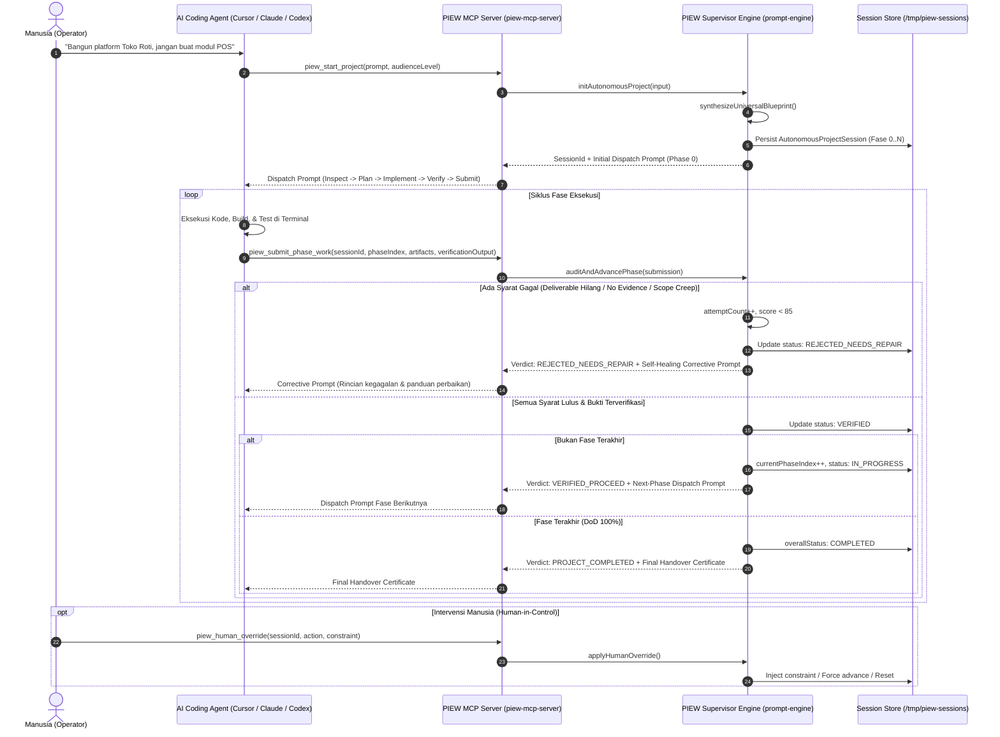

# ADR-004: Closed-Loop Autonomous Agent Supervision Engine via Model Context Protocol (MCP)

* **Status:** APPROVED / ACCEPTED (Tahap B Kanonis)
* **Tanggal:** 2026-10-15
* **Author:** AI Engineering & Architecture Team (PIEW Core)
* **Scope:** `packages/prompt-contracts`, `packages/prompt-engine`, `scripts/piew-mcp-server.ts`, `scripts/piew-cli.ts`

---

## 1. Konteks & Latar Belakang

Pada Tahap A (Universal Meta-Blueprint & Polymorphic Diagram Engine v2.3, PR #47 & PR #48), PIEW berhasil membangun mesin deterministik yang mampu menyusun rancangan rekayasa perangkat lunak dan domain universal 10-Bagian lengkap dengan diagram Mermaid yang tersanitasi serta bebas angka/entitas fiktif.

Namun, dalam eksekusi di dunia nyata oleh AI Coding Agents (Cursor, Claude Code, Codex CLI, Hermes Agent), timbul tantangan rekayasa baru:
1. **Claims without Evidence**: Agen sering mengklaim suatu fase "selesai" tanpa menjalankan pengujian nyata atau hanya melaporkan teks dangkal.
2. **Scope Creep & Negative Constraint Drift**: Agen sering melanggar batasan larangan pengguna (misal menambahkan pustaka atau modul yang secara eksplisit dilarang dalam prompt awal).
3. **Desinkronisasi Diagram vs Kode**: Entitas arsitektur yang sudah digariskan pada Diagram Mermaid (misal ERD atau Flowchart) diabaikan atau diganti secara sepihak oleh agen.
4. **Infinite Hallucination Loops**: Kegagalan yang berulang tanpa umpan balik terstruktur mengakibatkan token terbuang percuma tanpa kemajuan nyata.

Untuk mengatasi hal tersebut, **Tahap B** menetapkan arsitektur **Closed-Loop Autonomous Agent Supervision** di mana PIEW bertindak sebagai **Otak Arsitek & Pengawas (Supervisor)** yang memandu eksekutor melalui protokol stateful MCP.

---

## 2. Diagram Alur Siklus Supervisi Tertutup (Closed-Loop Supervision)

---

## 3. Empat Pilar Audit Pengawas (Supervisor Audit Matrix)

Setiap pengajuan hasil kerja fase (`PhaseSubmissionInput`) wajib melewati 4 lapis audit ketat:

| No | Pilar Audit | Tolok Ukur Keberhasilan | Konsekuensi Pelanggaran |
|---|---|---|---|
| 1 | **Deliverable Check** | Seluruh berkas/dokumen wajib fase tersebut tercantum nyata di `deliveredArtifacts` atau `summaryOfWork`. | `REJECTED_NEEDS_REPAIR`, Penalti skor -20 per item hilang. |
| 2 | **Cross-Artifact & Diagram Sync** | Entitas utama dari diagram Mermaid (ERD, Arsitektur, Flowchart) tidak dieliminasi atau bertentangan. | `REJECTED_NEEDS_REPAIR`, Penalti skor -15. |
| 3 | **Negative Constraint & Anti-Fake Guard** | Bebas dari larangan pengguna (*Scope Creep*, misal dilarang buat POS), serta tidak mengklaim selesai dengan mock/fake data palsu. | `REJECTED_NEEDS_REPAIR`, Penalti skor -25. |
| 4 | **Verification Evidence Guard (*Evidence over Claims*)** | `verificationOutput` memuat log nyata terminal (exit code 0, test pass, 0 errors) dan bebas unhandled failures. | `REJECTED_NEEDS_REPAIR`, Penalti skor -30. |

---

## 4. Bounded Retry & Human-in-Control

1. **Anti-Infinite Loop (Max Retries = 5)**:
   Sesuai Blueprint v1.0 Bagian 5.5, jika suatu fase gagal audit hingga 5 kali berturut-turut, sistem otomatis menghentikan siklus (`overallStatus: 'HALTED_MAX_RETRIES'`) untuk mencegah pemborosan token LLM dan meminta intervensi operator manusia.
2. **Human Override Tool (`piew_human_override`)**:
   Manusia memiliki kendali mutlak untuk:
   * Menyuntikkan batasan baru di tengah jalan (`INJECT_CONSTRAINT`).
   * Memaksa fase maju (`FORCE_ADVANCE`) atau mundur (`FORCE_ROLLBACK`).
   * Mereset counter retry (`RESET_RETRIES`).
   * Menjeda (`HALT`) atau melanjutkan (`RESUME`) sesi proyek.

---

## 5. Keputusan Penyimpanan Sesi (Durable & Zero-Pollution dev.db)

* Sesi supervisi disimpan secara **in-memory** diperkuat persistensi berkas JSON pada direktori persisten pengguna:
  * Primer: `~/.piew/sessions/` (tahan restart mesin/VPS).
  * Fallback terisolasi: `/tmp/piew-sessions/` jika izin akses terbatas.
  * Overridable via variabel lingkungan `PIEW_SESSION_DIR`.
* Hal ini menjamin **keutuhan 100% basis data SQLite `packages/database/prisma/dev.db`** tanpa penambahan tabel transien yang tidak perlu.

---

## 6. Pengerasan Mesin Menuju Tingkat Sempurna (Core Hardening v2.4.1)

Untuk mengeliminasi celah manipulasi teks oleh agent halusinasi, Tahap B2 menambahkan 3 kapabilitas pengerasan:

1. **Zero-Trust Active Execution Gate (`verificationCommand`)**:
   * Alih-alih pasif membaca teks `verificationOutput`, PIEW dapat mengeksekusi langsung perintah pengujian terminal (misal `npm test`, `cargo test`) di subprocess terisolasi dengan batas waktu (*timeout* 45 detik).
   * Exit code dan output terminal ditangkap langsung oleh kernel PIEW secara independen. Klaim palsu dari agent langsung digugurkan jika exit code $\neq 0$.
2. **Deep Artifact Inspector (On-Disk Existence & SHA-256 Check)**:
   * Memeriksa keberadaan file fisik di disk pada `workingDirectory`.
   * Menghitung ukuran berkas dan hash integritas SHA-256 untuk memastikan artefak bukan file kosong (0 bytes) atau stub dummy.
3. **Portable Handover Certificate & Bundle Exporter (`piew_export_handover_bundle`)**:
   * Menerbitkan `PIEW-AUDIT-CERTIFICATE-<sessionId>.md` dan `piew-handover-bundle-<sessionId>.json` secara portabel untuk audit compliance klien maupun arsip pipeline CI/CD.

---

## 7. Dampak & Backward Compatibility

* 100% kompatibel dengan kontrak v1 dan v2.
* Ekstensi bersifat aditif pada `packages/prompt-contracts/src/supervision.ts`.
* Menjadikan PIEW kompatibel secara standar dengan ekosistem Model Context Protocol (MCP) yang digunakan oleh Cursor, Claude Code, Windsurf, dan LLM CLI lainnya.
