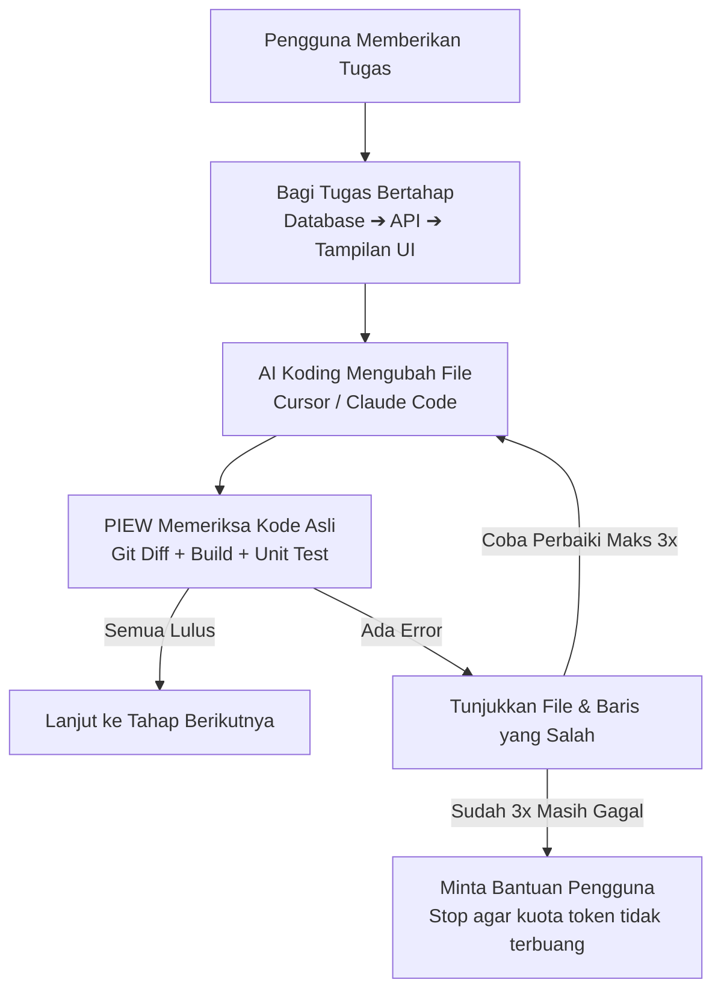
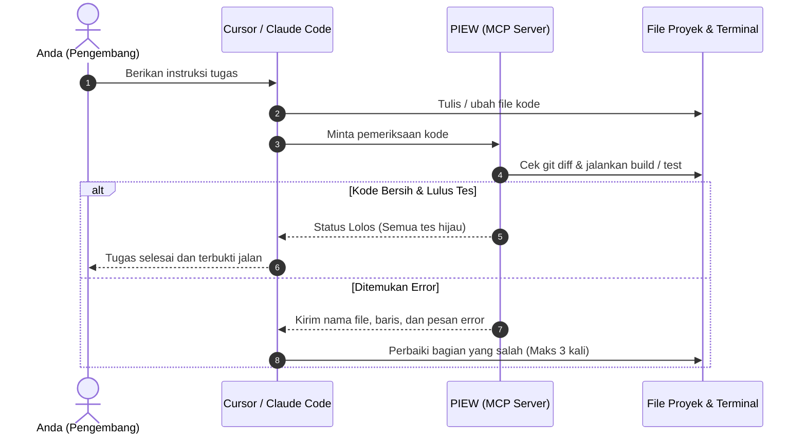

[English](../../README.md) · **Bahasa Indonesia**

# PIEW: Prompt Intelligence & Engineering Workspace

### Alat Pengawas dan Pengarah Kode untuk AI Coding Agent

**Membantu memeriksa hasil koding AI (seperti Cursor, Claude Code, dan Windsurf) lewat git diff, tes kompilasi, dan unit test agar kodenya benar-benar jalan dan tidak berputar-putar.**

[](https://piew.rskl.tech/)
[](https://www.typescriptlang.org/)
[](https://nodejs.org/)
[](https://modelcontextprotocol.io/)
[](#arsitektur-monorepo)
[](../../LICENSE)

---

**[Demo Aplikasi](https://piew.rskl.tech/)** · **[Mulai Cepat](#mulai-cepat)** · **[Kenapa Perlu PIEW](#kenapa-perlu-piew)** · **[Fitur Utama](#fitur-utama)** · **[Cara Kerja](#cara-kerja)** · **[Integrasi IDE (MCP)](#integrasi-ke-ide-ai-mcp)** · **[Penggunaan CLI](#penggunaan-lewat-terminal-cli)** · **[Struktur Folder](#arsitektur-monorepo)**

```bash
npm run piew -- --help
```

> [!NOTE]
> **Cek Bukti Nyata, Bukan Sekadar Laporan**: Agen koding AI sering melaporkan bahwa tugas sudah selesai, padahal kodenya masih ada yang error, test-nya gagal, atau ada file yang tidak sengaja terhapus. PIEW tidak langsung percaya pada teks laporan AI, melainkan memeriksa perubahan file asli (`git diff`) dan menjalankan perintah tes di terminal sebelum menganggap pekerjaan selesai.

---

## Kenapa Perlu PIEW?

AI coding agent seperti Cursor, Claude Code, atau Windsurf sangat cepat menulis kode, tetapi sering menghadapi kendala berikut:

| Masalah yang Sering Muncul | Dampak di Proyek | Solusi PIEW |
|---|---|---|
| **AI Mengaku Selesai Padahal Error** | Aplikasi error saat dijalankan karena ada import yang rusak atau salah ketik. | Cek langsung apakah perintah build (`tsc`) dan tes bernilai sukses (exit code 0). |
| **Muter-Muter Memperbaiki Error (Loop)** | AI berulang kali mencoba memperbaiki hal yang sama sampai kuota token habis. | Batasi maksimal 3 kali perbaikan. Jika masih gagal, sistem berhenti dan meminta arahan pengguna. |
| **AI Memakai Data Tiruan (Dummy)** | AI memakai data tiruan padahal aplikasi butuh database sungguhan. | Pasang aturan larangan mutlak agar AI tidak memakai data palsu atau menghapus tabel penting. |
| **Mengerjakan Terlalu Banyak Sekaligus** | AI mencoba membuat Database, API, dan UI sekaligus, sehingga kodenya banyak yang terpotong. | Bagi proyek ke beberapa tahap berurutan: selesaikan Database dulu, lalu API, baru buat UI. |

---

## Mulai Cepat

### 1. Hubungkan ke Cursor / Claude Desktop (Model Context Protocol)

PIEW bisa dihubungkan langsung ke Cursor atau Claude Desktop lewat MCP agar AI di editor Anda bisa memakai alat pemeriksa milik PIEW.

Tambahkan ke file konfigurasi MCP Anda (`cursor.json` atau `claude_desktop_config.json`):

```json
{
  "mcpServers": {
    "piew": {
      "command": "npx",
      "args": ["tsx", "scripts/piew-mcp-server.ts"]
    }
  }
}
```

Setelah terpasang, AI di editor Anda bisa otomatis mengecek pekerjaannya sebelum memberi tahu Anda bahwa tugas selesai.

### 2. Penggunaan Lewat Terminal (CLI)

Anda juga bisa menjalankan pengecekan langsung dari terminal:

```bash
# Cek apakah kode di folder kerja sudah bebas error dan lulus tes
npm run piew -- --audit --session=piew-proj-alpha --build-cmd="npm run typecheck" --test-cmd="npm test"

# Buat instruksi kerja terstruktur yang melarang hal tertentu
npm run piew -- "Buat sistem stok toko roti. DILARANG membuat modul POS fisik." --supervise
```

### 3. Menjalankan Tampilan Web (Next.js 15)

Anda dapat langsung mencoba aplikasi web yang sudah aktif di **[https://piew.rskl.tech/](https://piew.rskl.tech/)**, atau menjalankannya secara lokal:

```bash
# Pasang dependensi
npm install

# Jalankan server lokal
npm run dev --workspace=web
```
Buka browser di [http://localhost:3000](http://localhost:3000) untuk melihat halaman dasbor pengawasan, status tahapan tugas, dan riwayat pemeriksaan.

---

## Fitur Utama

```mermaid
flowchart TD
    Hub(["PIEW: Fitur Utama"])
    
    subgraph P1["1. Pemeriksaan Kode"]
        direction TB
        A1["Cek Perubahan File (Git Diff)"]
        A2["Uji Kompilasi & Unit Test"]
        A3["Cek Status Container Docker"]
        A4["Jaga Batasan & Aturan Larangan"]
    end

    subgraph P2["2. Pengarah Revisi"]
        direction TB
        B1["Tunjukkan File & Baris Error"]
        B2["Batas Perbaikan Maksimal 3 Kali"]
        B3["Pengerjaan Bertahap (DB ➔ API ➔ UI)"]
        B4["Eskalasi ke Bantuan Pengguna"]
    end

    subgraph P3["3. 10 Konektor MCP"]
        direction TB
        C1["GitHub & Linear (Kode & Tiket)"]
        C2["Sentry (Log & Rekaman Error)"]
        C3["Figma (Token Desain & UI)"]
        C4["Database, File Proyek, & Browser"]
    end

    Hub --> A1
    Hub --> B1
    Hub --> C1
```



### 1. Pemeriksaan Kode Asli (`packages/prompt-engine/src/supervisor/`)
* **Pemeriksa Git Diff**: Membaca file mana saja yang ditambah, diubah, atau dihapus secara nyata.
* **Pemeriksa Terminal**: Menjalankan tes dan kompilasi secara otomatis, lalu mencatat nama file dan nomor baris yang salah jika ada error.
* **Pemeriksa Docker**: Mengecek apakah container aplikasi berjalan normal atau mengalami restart terus-menerus (*crash-loop*).
* **Penjaga Aturan Larangan**: Memastikan AI tidak melanggar hal-hal yang dilarang pengguna (misalnya larangan memakai data dummy).

### 2. Arahan Revisi yang Jelas & Batas 3 Kali Coba
Saat menemukan kesalahan pada kode, PIEW tidak memberi saran yang membingungkan. PIEW memberikan arahan langsung:
1. **Penyebab Error**: Teks pesan error asli dari terminal.
2. **Lokasi File & Baris**: Nama file lengkap beserta nomor baris yang perlu diperbaiki.
3. **Langkah Perbaikan**: Tindakan yang harus diambil untuk menyelesaikan error tersebut.
4. **Hal yang Tetap Dilarang**: Batasan yang tidak boleh dilanggar selama perbaikan.

*Jika AI sudah mencoba 3 kali berturut-turut tapi kodenya masih error, PIEW akan menghentikan proses perbaikan otomatis agar token tidak terbuang percuma, lalu meminta bantuan pengguna.*

### 3. 10 Konektor Tambahan (MCP) (`packages/provider-adapters/src/mcp-catalog.ts`)
Alat bantu siap pakai untuk alur kerja pengembangan aplikasi:
* **GitHub**: Kelola branch, commit, dan review pull request.
* **Linear**: Sinkronisasi tiket tugas dan status pekerjaan.
* **Sentry**: Baca log error dan rekaman stack trace aplikasi.
* **Figma**: Ambil spesifikasi warna dan tata letak desain UI.
* **Docker**: Cek status container lokal dan baca log service.
* **Database**: Tes query dan cek tabel di database PostgreSQL / SQLite.
* **Brave / Firecrawl Search**: Cari dokumentasi teknis di web secara aman.
* **File System**: Baca dan tulis file di folder proyek dengan aman.
* **Memori**: Simpan dan panggil catatan penting AI agar tidak lupa.
* **Puppeteer**: Buka browser tanpa tampilan untuk cek tampilan web dan ambil tangkapan layar.

---

## Cara Kerja

### 1. Alur Pengawasan Bertahap



### 2. Alur Interaksi IDE & PIEW (MCP)



---

## Arsitektur Monorepo

Struktur proyek dibagi menjadi paket-paket terpisah yang rapi:

```text
prompt-workspace/
├── apps/
│   └── web/                         # Tampilan web Next.js 15 (Tailwind CSS, Lucide)
│       └── src/app/api/             # Jalur API (/api/supervision, /api/agent-runs, /api/skills)
│
├── packages/
│   ├── prompt-contracts/            # Format data Zod untuk memastikan struktur tetap konsisten
│   ├── prompt-engine/               # Mesin utama dan modul pengawas kode
│   │   ├── src/supervisor/          # Alat cek git diff, terminal, dan pengarah revisi
│   │   └── scripts/                 # File pengujian otomatis
│   ├── provider-adapters/           # Penghubung AI provider dan 10 alat MCP
│   ├── prompt-crawler/              # Pengambil dokumentasi teknis dari website
│   ├── prompt-spider/               # Alat uji ketahanan prompt
│   ├── domain-rules/                # Kumpulan aturan penulisan prompt
│   └── database/                    # Database SQLite dan Prisma ORM
│
├── docs/
│   ├── readme/                      # Dokumentasi multi-bahasa (README_id.md)
│   ├── architecture/                # Catatan keputusan teknis (ADR)
│   └── product/                     # Catatan pembaruan versi
│
├── scripts/
│   ├── piew-cli.ts                  # Perintah terminal (CLI)
│   └── piew-mcp-server.ts           # Server MCP untuk Cursor / Claude
│
├── SUPERVISOR_EXECUTION_STATE.md    # Catatan riwayat pemeriksaan yang tersimpan di disk
├── RANCANG_BANGUN_PIEW_AUTONOMOUS_SUPERVISOR.pdf  # Dokumen penjelasan teknis 8 halaman
└── package.json                     # Pengaturan utama proyek
```

---

## Perintah Kerja di Terminal

Perintah yang sering digunakan untuk mengecek kode:

```bash
# Cek apakah ada error di penulisan TypeScript
npm run typecheck

# Jalankan pengujian modul pengawas
npx tsx packages/prompt-engine/scripts/test-empirical-supervisor.ts

# Tes koneksi perkakas MCP
npm run test:mcp

# Cek koneksi provider AI
npm run test:providers

# Build seluruh paket aplikasi
npm run build
```

---

## Lisensi

Proyek ini menggunakan lisensi MIT. Silakan lihat file [LICENSE](../../LICENSE) untuk informasi lengkap.
